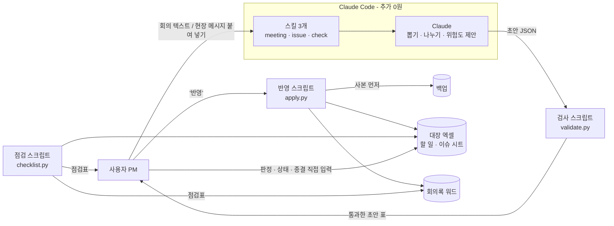

# 아키텍처

> 상태: 승인(2026-11-19 사용자 "승인, 코드로") · 2026-11-19 · 근거: [requirements.md](requirements.md) 2판(AC-01~44)

## 1. 한 줄

말을 다루는 일(뽑기 · 나누기 · 제안)은 Claude가 하고, 규칙으로 정해지는 일(검사 · 정렬 · 가리기 · 저장)은 Python 스크립트가 한다. 사람은 초안을 보고 '반영'하고, 판정은 엑셀에서 직접 한다.

이렇게 나누는 이유: 규칙을 스크립트에 두면 단위 시험으로 매번 같은 결과를 확인할 수 있다. AI가 실수해도 스크립트 검사가 대장에 들어가기 전에 막는다(AC-06 · AC-31 · AC-43).

## 2. 구성도

## 3. 구성요소 역할

| 구성요소 | 위치 | 하는 일 | 하지 않는 일 | 관련 AC |
|---|---|---|---|---|
| 스킬 `meeting` | `.claude/skills/meeting/SKILL.md` | 회의 텍스트를 받아 할 일 · 회의록 내용 초안을 JSON으로 쓰게 하고, 검사 · 초안 표 보여 주기까지 이끈다 | 대장에 직접 쓰기 | AC-01 · 03 · 11 · 13 |
| 스킬 `issue` | `.claude/skills/issue/SKILL.md` | 현장 메시지를 받아 이슈 초안 JSON을 쓰게 하고, 되물은 답 덧붙이기를 이끈다 | 위험도 확정 · 판정 | AC-27 · 32 · 33 |
| 스킬 `check` | `.claude/skills/check/SKILL.md` | 점검 스크립트를 돌려 닫히지 않은 항목을 보여 준다 | 대장 고치기 | AC-14 |
| Claude(모델) | Claude Code 구독 | 할 일 뽑기, 재현 조건 · 증상 · 기대 결과 나누기, 위험도 제안과 근거 인용, 되물을 질문, 중복 의심 | 사람 칸 쓰기, 숫자 · 이름 지어내기 | AC-05 · 17 · 18 · 28 · 30 · 39 |
| `parse.py` | `src/` | 회의 텍스트 줄을 `[분:초]` · `[시:분:초]`로 읽고 길이를 잰다 | — | AC-02 · 09 · 22 · 24 |
| `mask.py` | `src/` | 현장 메시지의 이름 · 전화번호를 가린다 | — | AC-38 |
| `rules.py` | `src/` | 안전 낱말 → A, 점검표 정렬, 7일 지연 판단 | — | AC-21 · 29 · 36 |
| `validate.py` | `src/` | 초안 JSON 검사: 근거 인용이 원문에 있는지, 사람 칸이 비었는지, 값 목록 안인지, 질문 1~3개인지 | 고쳐 쓰기(실패하면 이유만 보고) | AC-05 · 06 · 31 · 32 · 35 · 43 |
| `apply.py` | `src/` | '반영' 뒤 백업 → 대장 추가 → 회의록 워드 만들기. 파일이 열려 있으면 멈춤 | 기존 행의 사람 칸 바꾸기 | AC-04 · 12 · 20 · 25 · 33 · 34 · 40 |
| `checklist.py` | `src/` | 닫히지 않은 할 일 · 이슈를 정렬 · 지연 표시해 표로 낸다 | 대장 고치기 | AC-13 · 14 · 21 · 36 |
| `score.py` | `eval/` | 가상 데이터 정답과 초안을 비교해 채점 | — | AC-07 · 19 · 41~44 |
| `human_edits.py` · `build_demo.py` | `eval/` | 시나리오에서 사람이 엑셀로 하는 판정을 흉내 내고(사람 몫으로 표시), 실행 결과를 시연 데이터로 묶는다 | AI 판단 | AC-46 · 47 |
| 가상 데이터 | `samples/` | 회의 3건 · 현장 메시지 12건 · 정답 목록 | 실제 자료 | F8 · Q14 |
| 시연 페이지 | 저장소 맨 위 `index.html` · `site/` | GitHub Pages에서 가상 데이터와 미리 돌린 AI 초안을 보여 주고, 방문자의 판정에 따라 점검표를 다시 그린다. 규칙은 `src/rules.json`을 읽는다 | 실시간 AI 호출, 실제 데이터 | AC-45~50 |
| 실제 데이터 폴더 | 저장소 밖(기본 `C:\dev\meeting-actions-data\`) | 대장 · 회의록 · 초안 · 백업 · 입력 | git 추적 | AC-10 |

## 4. 기술 선택

| 항목 | 선택 | 이유 | 비용 |
|---|---|---|---|
| 실행 환경 | Claude Code 스킬 | 구독 안에서 돎(ADR 0001) | 0원 |
| 스크립트 | Python 3.12(이 PC에 있음) | 엑셀 · 워드 라이브러리가 있다 | 0원 |
| 엑셀 | openpyxl | .xlsx 읽기 · 쓰기 | 0원(설치 필요) |
| 워드 | python-docx | .docx 만들기 | 0원(설치 필요) |
| 시험 | pytest | 단위 시험 | 0원(설치 필요) |
| 초안 형식 | JSON | AI 출력과 스크립트 사이 약속. 검사하기 쉽다 | — |

Claude API · 서버는 쓰지 않는다(AC-26). 시연 페이지는 GitHub Pages 정적 호스팅(0원)만 쓴다(ADR 0003).

## 5. 호출 흐름 (요약)

자세한 순서도는 [flows.md](flows.md).

1. 회의: 사용자 `/meeting` + 텍스트 → `parse.py`(형식 · 길이) → Claude 초안 JSON → `validate.py` → 초안 표 → '반영' → `apply.py`(백업 → 할 일 추가 → `checklist.py`로 점검표 → 회의록 워드).
2. 이슈: 사용자 `/issue` + 메시지 → `mask.py` → Claude 초안 JSON → `rules.py`(안전 낱말) → `validate.py` → 초안 표 → '반영' → `apply.py`(백업 → 이슈 추가).
3. 점검: `/check` → `checklist.py` → 표(대장은 그대로).

## 6. 지키는 경계

- 대장을 쓰는 곳은 `apply.py` 하나뿐이다. Claude는 대장 파일을 직접 고치지 않는다(AC-20 · 31).
- 사람 칸(위험도 확정 · 판정 · 상태 변경 · 조치 · 지연 사유 · 종결)은 `apply.py`가 새 행에서 비워 두거나 시스템 기본값만 넣는다. 기본값(할 일 '예정', 이슈 '접수')은 AI 판단이 아니라 고정 규칙이다.
- 실제 데이터 폴더 경로는 `config.json`에 두고, `config.json`과 데이터 폴더는 `.gitignore`에 넣는다(AC-10).

## 7. 설계에서 정한 것 (요구 가정 처리)

| 가정 | 설계 제안 | 이유 |
|---|---|---|
| AS-10 중복 의심 기준 | Claude가 닫히지 않은 이슈 목록과 비교해 같은 재현 조건이나 증상으로 보이면 번호와 근거 문장을 붙인다. 표시만 하고 합치지 않는다 | 낱말 일치 규칙은 "3번 열" · "세 번째 줄"처럼 표현이 달라 놓친다. 최종 판단은 사람 |
| AS-11 사본 개수 | 모두 남긴다(지우지 않음). 정리는 사람이 한다 | 파일이 작다. 자동 삭제는 되돌릴 수 없다 |
| 할 일의 위험도 | 관련 이슈가 있으면 그 이슈의 확정 위험도를 복사하고, 없으면 비워 둔다(사람이 채움). 점검표에서 빈 위험도는 C 다음 | AC-31(AI가 위험도를 확정하지 않음)과 AC-35(A/B/C 통일)를 함께 지키려고 |

## 8. 3주 가상 시나리오에서 드러난 한계 (2026-11-19)

정답을 보지 않는 별도 실행으로 3주 시나리오를 돌린 결과는 [eval/result.md](../eval/result.md)에 있다. 기준은 모두 통과했고, 아래는 다음에 다룰 한계다.

| 한계 | 영향 | 다음 |
|---|---|---|
| 중복 의심 번호가 초안 표에만 보이고 대장 16칸에는 남지 않는다 | 반영 뒤에는 사람이 기억해야 한다 | 요구 수정안(칸 추가)을 먼저 제안 |
| 되물은 답에서 '화면에 뜬 말'처럼 기존 칸에 맞지 않는 정보는 재현 조건에 섞인다 | 정보가 한 칸에 몰린다 | 덧붙이기 규칙 보강 |
| 범위가 바뀐 할 일(예: 경사 시험 축소)을 이전 할 일과 잇는 칸이 없다 | 이전 할 일이 열린 채 남는다 | 사람이 엑셀에서 닫는다. 칸 추가는 요구 수정 뒤 |
| 실행 1회 · 메시지 12건 · 회의 3건으로 잰 값이다 | 숫자가 흔들릴 수 있다 | 실제 사용 전 표본을 늘려 다시 잰다 |

## 9. 바뀌면 같이 고칠 문서

구조가 바뀌면 이 문서와 [data-model.md](data-model.md) · [flows.md](flows.md)를 같은 커밋에서 고친다.
