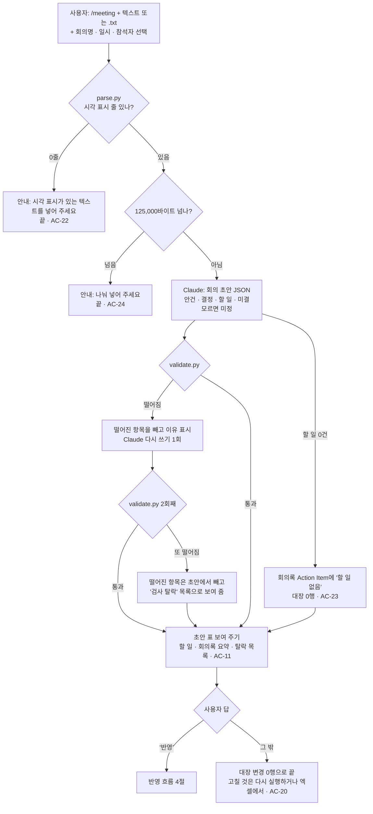
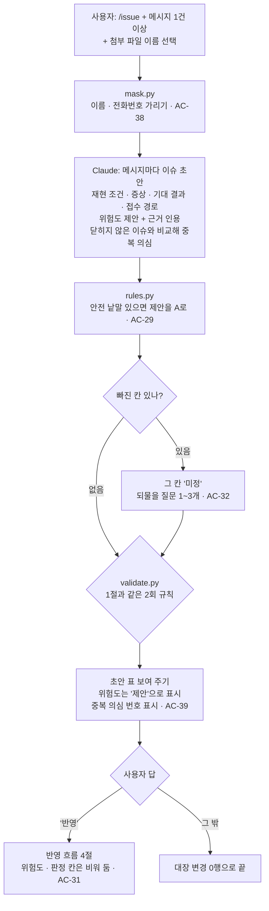
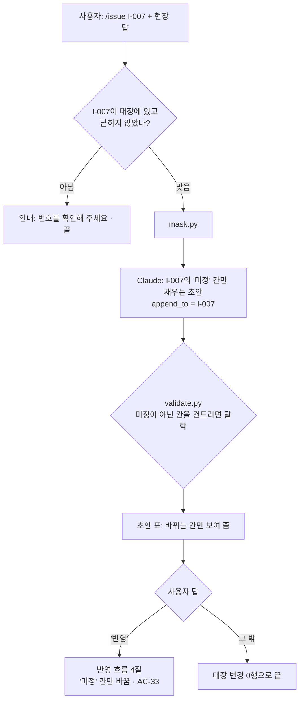
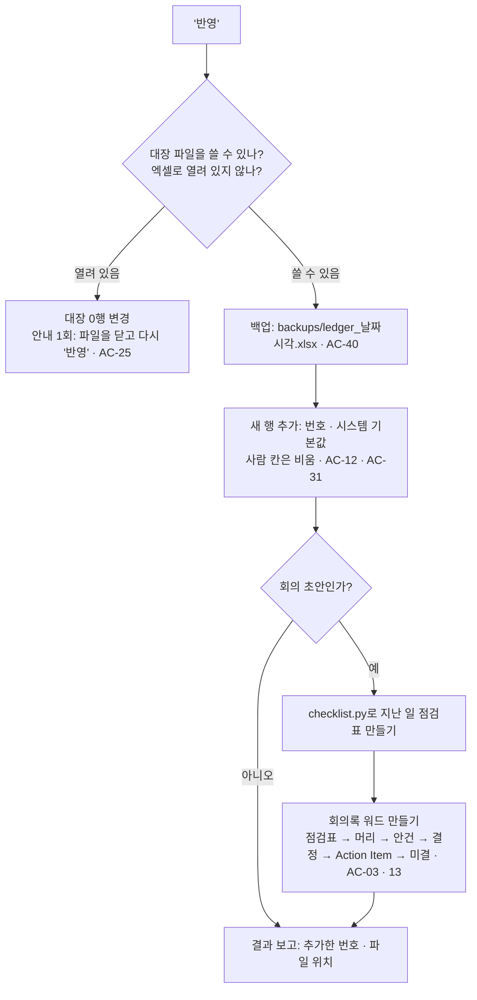
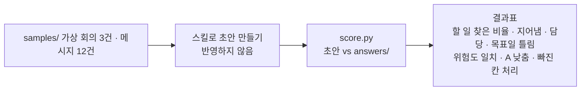

# 흐름 설계

> 상태: 승인(2026-11-19 사용자 "승인, 코드로") · 2026-11-19 · 근거: [requirements.md](requirements.md) 2판 · [architecture.md](architecture.md) · [data-model.md](data-model.md)

흐름마다 끝나는 조건을 적는다. AI와 같은 일을 끝없이 주고받지 않게 하기 위해서다.

## 1. 회의 정리 `/meeting`



끝나는 조건: 형식 오류(바로 끝), 검사는 다시 쓰기 포함 최대 2회, 초안 표는 1회 보여 주고 사용자 답을 기다린다. '반영'이 아니면 아무것도 쓰지 않고 끝난다.

## 2. 현장 이슈 접수 `/issue`



사진은 분석하지 않는다. 사용자가 알려 준 파일 이름만 '첨부 파일 이름' 칸에 적는다(AC-37).

## 3. 되물은 답 덧붙이기 `/issue I-007`



끝나는 조건: 덧붙이기로도 여전히 '미정'인 칸이 남으면, 새 질문을 만들지 않고 '미정'으로 둔다. 다시 물을지는 PM이 정한다. 질문 → 답 → 질문이 끝없이 이어지지 않게 하기 위해서다.

## 4. 반영 (`apply.py`)



끝나는 조건: 파일이 열려 있으면 안내 1회 뒤 끝난다. 다시 시도는 사용자가 '반영'을 다시 말할 때만 한다(자동 재시도 없음).

## 5. 점검 `/check` (`checklist.py`)

```mermaid
flowchart TD
  A[/check 또는 회의록 만들 때] --> B[대장에서 닫히지 않은 할 일 · 이슈 모으기<br/>할 일 ≠ 완료, 이슈 ≠ 종결]
  B --> C[정렬: 위험도 A → B → C → 빈칸<br/>같은 등급은 목표일 빠른 순 · '미정'은 뒤 · AC-21]
  C --> D[목표일이 오늘보다 7일 넘게 지났으면 '지연' 표시 · AC-36]
  D --> E[표로 보여 주기 · 대장 변경 0행 · AC-14]
```

경계값: 목표일에서 7일 지난 날은 '지연'이 아니고, 8일 지난 날부터 '지연'이다(단위 시험 7 · 8일).

## 6. 채점 (`eval/score.py`)



| 지표 | 기준 | AC |
|---|---|---|
| 정답 할 일 찾은 비율 | 90% 이상 | AC-07 |
| 지어낸 할 일 · 재현 조건 · 증상 | 0건 | AC-06 · 43 |
| 담당 · 목표일 틀림('미정' 제외) | 0건 | AC-19 |
| 위험도 제안 일치 | 12건 중 10건 이상 | AC-41 |
| 정답 A를 B · C로 제안 | 0건 | AC-42 |
| 조건 빠진 3건의 '미정' + 질문 1~3개 | 100% | AC-44 |
| 1차 미완료 할 일이 2 · 3차 점검표에 나옴 | 100% | AC-13 |

채점에서 기준에 못 미치면 스킬 설명문 · 규칙을 고친 뒤 다시 돌린다. 다시 돌리기는 한 번에 사용자 승인 1회씩 한다(무한 반복 금지).

## 7. 시연 이야기 (가상)

1. 1주차: 현장 메시지 6건 접수(`/issue`) → 반영 → 1차 회의 텍스트(`/meeting`)에서 이슈 몇 건을 판정하고 할 일이 나옴 → 반영 → 회의록 1.
2. 2주차: 조건 빠진 메시지에 되물은 답 덧붙이기 → 새 메시지 접수 → 사용자가 엑셀에서 일부 판정 · 상태 변경 → 2차 회의록 맨 앞 점검표에 1차 미완료 항목이 위험도 순으로 나옴.
3. 3주차: 목표일을 넘긴 항목에 '지연' 표시 → 3차 회의에서 범위 줄이기 · 미루기를 정하고 할 일로 남김.
